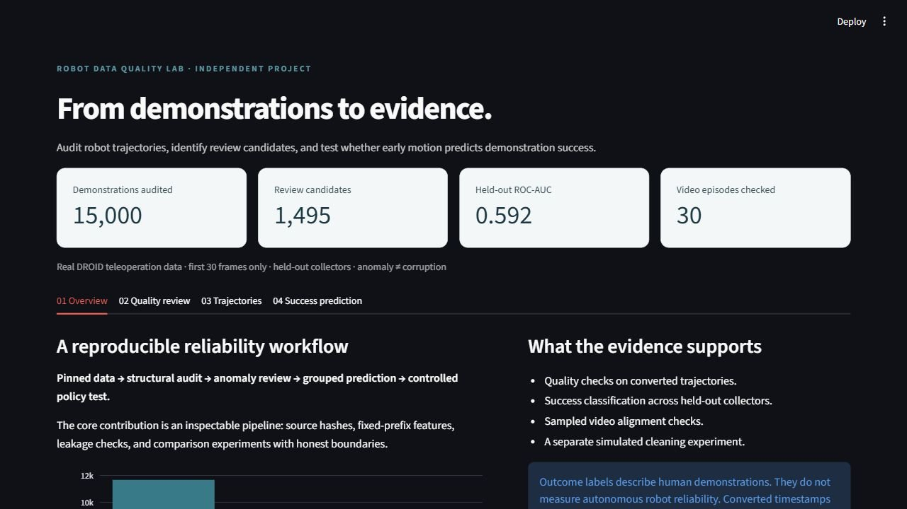
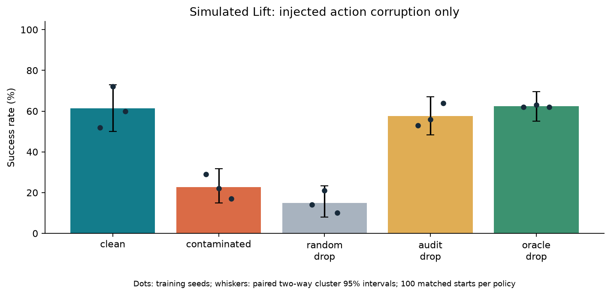
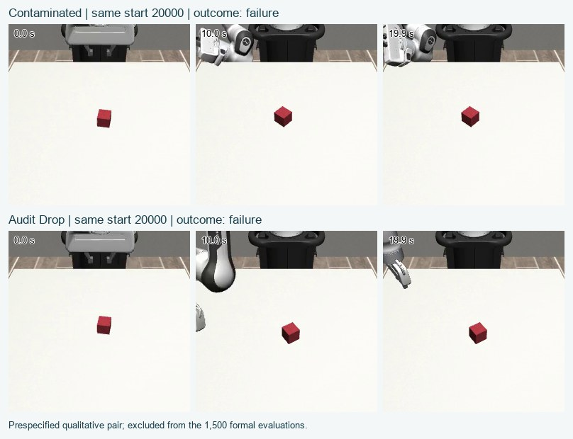
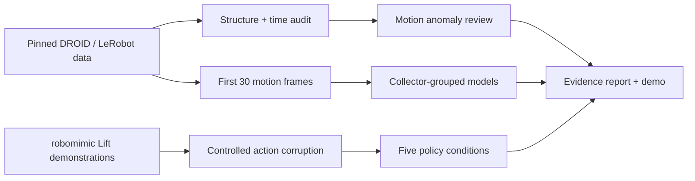

# Robot Data Quality & Success Prediction

A reproducible portfolio project for AI data and algorithm engineering: audit real robot demonstrations, predict eventual demonstration success from early motion, and test cleaning in a separate simulated policy experiment.

**Status:** real-data audit, prediction and the controlled policy experiment are complete: **15,000 demonstrations**, **30 sampled videos**, and **1,500 simulated policy rollouts**. Research-control tests, independent result verification, and a clean-kernel Colab resume check passed. The local demo includes traceable simulation clips.

| Model | Held-out ROC-AUC | Failure PR-AUC | Failure recall |
|---|---:|---:|---:|
| constant_prior | 0.500 | 0.245 | 1.000 |
| logistic_regression | 0.648 | 0.376 | 0.533 |
| lightgbm | 0.592 | 0.333 | 0.548 |

The validation-selected model is **lightgbm**. Its validation ranking did not carry over to held-out collectors; the simpler logistic regression achieved the higher test AUC. The original resume AUC of 0.85 is not supported by this experiment.



An independent environment regenerated 156 prefix features and all three model predictions for one real held-out success and one failure episode. See [`reports/real_sample_verification.json`](reports/real_sample_verification.json). Full methods and uncertainty are in the research report.

## Controlled policy results

Simulated robomimic Lift, 10% of training demonstrations with injected action corruption, three prespecified training seeds, 60,000 updates per policy, and 100 shared initial states per seed:

| Training data | Successes / rollouts | Success rate | 95% interval |
|---|---:|---:|---:|
| Clean | 184 / 300 | 61.3% | 50.0–73.0% |
| Contaminated | 68 / 300 | 22.7% | 15.0–31.7% |
| Randomly drop 10% | 45 / 300 | 15.0% | 8.0–23.3% |
| Audit-filtered, drop 10% | 173 / 300 | 57.7% | 48.3–67.0% |
| Oracle-filtered, drop 10% | 187 / 300 | 62.3% | 55.0–69.7% |

Audit filtering improved success over contaminated data by **35.0 percentage points** (95% interval **21.0–48.7**), and over random filtering by **42.7 percentage points**. Intervals use 2,000 paired two-way cluster bootstrap resamples over training seeds and shared initial states. The detector recovered 10 of 18 injected corruptions; random filtering recovered 1 of 18. The oracle uses injection answers only as a reference condition. This is one simulated task and one fixed corruption draw, with only three training seeds; it does not demonstrate an improvement on real DROID or a physical robot.



The 1,500-row CSV was compared against all 15 original per-policy cloud logs. Counts, state hashes, training budgets, source hashes, means and intervals can be checked locally with `python -B scripts/verify_policy_results.py`; this requires neither a simulator nor raw demonstration data. See [`policy_results.json`](reports/policy_results.json), [`policy_rollouts.csv`](reports/policy_rollouts.csv) and [`policy_cloud_verification.json`](reports/policy_cloud_verification.json).

### Simulation clips and selection boundaries



The paired [contaminated](reports/figures/contaminated_seed17_20000.mp4) and [audit-filtered](reports/figures/audit_drop_seed17_20000.mp4) clips use training seed 17 and an additional shared start, 20000, fixed before viewing. **Both fail within the 400-step horizon**; they are retained and excluded from the formal metrics. A separate [clean-policy success illustration](reports/figures/clean_seed17_10003.mp4) was explicitly selected after evaluation as the first successful clean-seed17 start above 10000. It reproduces the original start-state hash and success at step 42. It is an illustration, not a representative sample.

Exact replay preserves the original environment-construction seed (10000), as well as the reset seed (10003). The optional Colab cell documents this distinction, uses CPU software rendering, and checks the replay against the original evaluation record. Default sequential runs skip optional rendering. Clip hashes and selection rules are in [`policy_qualitative.json`](reports/policy_qualitative.json).

## Why this project

Robot learning depends on demonstration quality. This project makes that dependency inspectable with bounded downloads, source hashes, structural/time checks, anomaly review, collector-held-out evaluation, and a controlled policy comparison. The contribution is the research and engineering pipeline, not a new foundation model.



## Data and attribution

- Real data: [DROID](https://droid-dataset.github.io/), using the community [LeRobot success conversion](https://huggingface.co/datasets/jnogga/droid_success) and [failure conversion](https://huggingface.co/datasets/jnogga/droid_failure), CC BY 4.0. Credit to the DROID authors and conversion maintainer. These converted datasets already exclude some inconsistent raw episodes.
- Simulation data: [robomimic datasets](https://huggingface.co/datasets/robomimic/robomimic_datasets), [MIT dataset card](https://huggingface.co/datasets/robomimic/robomimic_datasets/blob/74fa018461f479cd9fd15b924a16103012096203/README.md); environment [robosuite](https://github.com/ARISE-Initiative/robosuite), powered by MuJoCo. This project implements its own small PyTorch BC network using the released environment metadata.
- Data commits are pinned in `configs/project.yaml`; downloaded file SHA256 values are recorded. Raw data is not redistributed in this repository. Source licenses govern source data; the MIT license here covers project code.

## Run on Windows, with project writes on D:

Use an existing Python 3.12 interpreter. The bootstrap script creates a dedicated environment on D: and installs the measured versions from `requirements-lock-windows.txt` when available. It does not install Python, CUDA, Docker, WSL, or a browser on C:.

```powershell
# Run from the project directory on D:
.\scripts\bootstrap.ps1 -BasePython 'PATH_TO_EXISTING_PYTHON.exe'
.\scripts\run.ps1 preflight
.\scripts\run.ps1 test
.\scripts\run.ps1 fetch
.\scripts\run.ps1 audit
.\scripts\run.ps1 detect
.\scripts\run.ps1 train
.\scripts\run.ps1 video --episodes 30
.\scripts\run.ps1 report
.\scripts\run.ps1 demo
```

`fetch --small` selects a clearly smaller cohort for a network smoke test; do not mix its results with the full experiment. Public downloads do not require a Hugging Face token. Downloading selected episodes can require entire shared Parquet shards (~7.2 GB controls across both sources); videos have a separate 8 GiB cap. Total project storage is capped at 30 GiB. Partial downloads and episode audit checkpoints can resume. Changing audit/feature code invalidates audit checkpoints.

All project-controlled caches, temporary files, environments and outputs are rooted under the project. The startup guard resolves paths and rejects escapes or Windows drives other than D:. Cloud checkpoint paths require a real DriveFS mount on every workspace access; an ordinary directory left after a disconnection is rejected. Existing Windows/browser application logs are outside this project's write control.

To execute the main notebook in saved-results inspection mode, use `.\.venv\Scripts\python.exe -B scripts/verify_notebook.py --save`. The verifier launches an isolated kernel on the local loopback interface, keeps Jupyter data and connection files under the project cache, executes all five code cells, and embeds the measured figures. It does not register a kernel in AppData or rerun the full experiment. The receipt is `reports/notebook_verification.json`.

For a clean Linux/CI/cloud workspace, install `requirements.txt`, set `PYTHONPATH=src`, and use `python -m robot_audit --root /content/robot-audit COMMAND` (or a `/home/...` workspace). See the main notebook.

## Research protocol

**Real data.** Target 12,000 successful and 3,000 failed demonstrations after UUID checks, excluding episodes shorter than 30 frames. Full/prefix motion duplicates are excluded conservatively. Split by collector (approximately 5/7 train, 1/7 validation, 1/7 test). All models use fixed-prefix motion features only. No source, text, IDs, total duration, reward or terminal state is a feature. Imputation/scaling fit on training data. Thresholds and presentation model are chosen on validation; test results remain held out. ROC-AUC, failure PR-AUC, failure recall, confusion matrices and collector-bootstrap intervals are reported.

**Quality.** Rules detect structure and converted time inconsistencies. Motion outliers and Isolation Forest scores identify review candidates. Task failure is not a corruption label. MP4 checks apply only to the reported sample and converted timestamps, not original sensor-clock drift.

**Cloud verification.** The final core notebook was restarted and run in order in a fresh Python kernel on the existing fixed CPU VM. Its five core cell sources matched the repository, execution counts restarted at 1, all acceptance checks passed, and existing checkpoints/evaluations resumed without training. This verifies clean-kernel resumption; it is not a second full retraining or a fresh-VM experiment. See [`colab_verification.json`](reports/colab_verification.json).

**Policy.** The dedicated [Colab notebook](notebooks/01_colab_policy.ipynb) performs the simulated Lift experiment. It requires a free runtime and user-authorized Google Drive mounting for checkpoints. Use 180/20 released train/validation demonstration masks; inject finite action spikes/misalignment into 10% of training episodes only. Compare clean, contaminated, random-drop, audit-drop and oracle-drop at equal optimization budgets. A simulator smoke check verifies observations, actions and reproducible resets before the clean pilot. The pilot requires at least 70% on 20 independent starts before freezing one of 30k/60k/90k steps. The retained complete pilot records verify **14/20 at 60,000 steps**, the frozen formal budget. Three prespecified seeds, 100 matched evaluation starts per policy, 1,500 formal rollouts total. Initial-state hashes and training budgets must match. Report percentage-point differences and paired two-way cluster bootstrap intervals over training seeds and shared initial states. Failed/negative results are retained.

## Inspect the evidence

- `reports/research_report.md`: question, methods, measured results and limitations.
- `reports/prediction_metrics.json`: model selection, validation/test metrics and uncertainty.
- `reports/audit_summary.json`, `reports/video_summary.json`: actual coverage.
- `reports/policy_results.json`, `reports/policy_rollouts.csv`: complete formal results and all 1,500 rollout records.
- `reports/policy_protocol.json`, `reports/policy_injection_truth.json`: frozen budget and traceable fault injection records, kept separate from the detector.
- `reports/cloud_source_manifest.json`, `reports/cloud_requirements.txt`: actual CPU training environment and source provenance, including the resumed run.
- `reports/resume_evidence.md`: fact-bounded English bullets and Chinese interview explanation.

The local Streamlit app has four views: overview, quality review, trajectories, and success prediction. Missing outputs display a pending state rather than invented demo scores. No hosting subscription is required.

## Important boundaries

Labels describe human demonstrations, not autonomous robot reliability. Collector-held-out testing does not establish unseen-task or unseen-scene generalization. Success and failure cohorts come from separate converted repositories; residual task, collection or conversion differences may contribute to discrimination even after explicit source fields are excluded. The selected 80/20 outcome prevalence affects precision/calibration. Simulated injected-corruption results cannot establish real DROID policy improvements. CI checks research controls with synthetic fixtures and does not rerun the multi-GB real-data experiment.

## References

Khazatsky et al. (2024), *DROID: A Large-Scale In-the-Wild Robot Manipulation Dataset*.

Mandlekar et al. (2021), *What Matters in Learning from Offline Human Demonstrations for Robot Manipulation*.
