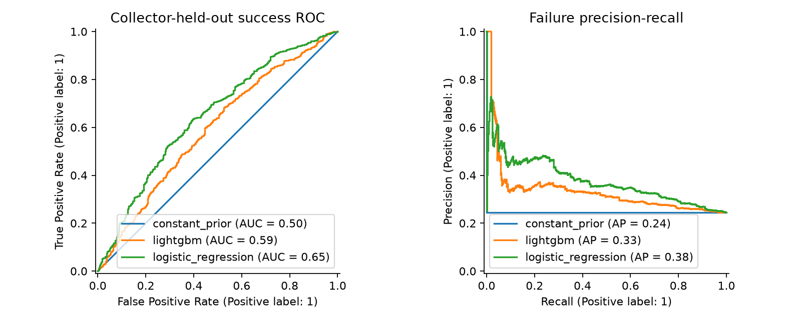

# Research report: robot demonstration quality and success prediction

## Question and contribution
Can a reproducible audit identify review candidates in robot demonstrations, and can the first 30 frames predict eventual demonstration success under a collector-held-out split?

This project implements the data adapters, bounded/resumable downloads, motion features, quality rules, anomaly ranking, group-safe evaluation, and a separate controlled policy experiment. It does not introduce a new robot foundation model or claim real-robot deployment.

## Data and audit coverage
- Audited episodes: **15,000**; classifier-eligible episodes after content/prefix deduplication: **15,000**.
- Selected outcome counts: {'1': 12000, '0': 3000}; collectors in selection: 80.
- Upstream duplicate UUID rows: 36; conflicting UUIDs quarantined: 36.
- Review flags: 1,495. These are review suggestions, not verified corruptions.
- Timestamp checks apply to converted 15-Hz storage. Original sensor-clock drift is not measurable from these files.
- Video: {"sample_episodes": 30, "decoded_episodes": 30, "sample_cameras": ["observation.images.left_external"], "download_bytes": 6123971692, "video_quota_bytes": 8589934592, "frame_count_mismatches": 0, "decode_errors": 0, "sampling": "outcome x anomaly flag stratified sample, limited by shard byte budget", "scope": "Converted MP4 and converted timestamps only; not original sensor clocks; no whole-dataset video claim."}.

## Prediction protocol
Only fixed-prefix motion signals are allowed. Task text is absent for all failure episodes and is excluded, along with source path, IDs, full duration, outcome/reward and terminal data. Scaling, imputation, anomaly thresholds and model fitting use training data only. The failure threshold and presentation model are selected on validation data. Test collectors stay held out.

Actual split counts: {'train': 11674, 'validation': 1679, 'test': 1647}; collector counts: {'test': 10, 'train': 53, 'validation': 17}. Sampling deliberately targets an 80/20 outcome mix; precision and calibration reflect this sampled distribution, not an operational fleet prevalence.

| Model | Test ROC-AUC | Failure PR-AUC | Failure recall |
|---|---:|---:|---:|
| constant_prior | 0.500 | 0.245 | 1.000 |
| logistic_regression | 0.648 | 0.376 | 0.533 |
| lightgbm | 0.592 | 0.333 | 0.548 |

Validation-selected model: **lightgbm**. Test AUC 95% collector-bootstrap CI: [0.47261869261141887, 0.664463766944018]. Three baselines are prespecified; no search for a target AUC of 0.85 was performed. Full metrics, threshold and confusion matrices are in `prediction_metrics.json`.

## Controlled policy experiment
Status: **pending — no policy improvement claim**.

The policy comparison has not completed. No downstream improvement is claimed.

## Limits and interpretation
- Labels describe human teleoperated demonstrations, not autonomous policy execution.
- The community conversion already removed some inconsistent episodes; findings do not estimate all raw DROID defects.
- Collector grouping tests transfer across collectors, not verified unseen scenes or unseen tasks.
- Motion anomaly and task failure are separate concepts. Isolation Forest scores do not establish corruption or causation.
- A small, budget-limited video sample cannot establish whole-dataset camera quality.
- Controlled simulation results do not establish that filtering real DROID improves a physical robot.

## Reproducibility
Pinned data commits: `source_versions.json`; downloaded file SHA256 values recorded. Project seed 42. Windows dependency versions: `requirements-lock-windows.txt`. Policy checkpoints include optimizer/RNG state. Formal policy comparisons require all 1,500 rollouts and identical initial-state hashes. CI uses synthetic fixtures clearly separated from real-data metrics.
